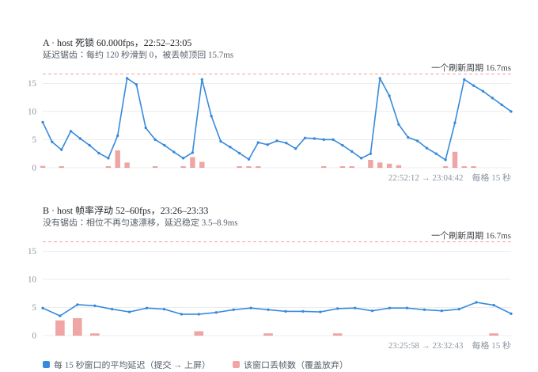

# 提交即覆盖（overwrite）：显示端延迟从锁死 32.7ms 降到 3.5–5.9ms

日期：2026-11-18　设备：`<BOX_IP>`（CM311-1A / S905L3A，内核 5.15）
参数：`2560x1440@60` H.265 / 26000 kbps / packetsize 1440 → 输出 `3840x2160@60`
代码：`src/video/drmzero.c`（[benny391/moonlight-embedded](https://github.com/benny391/moonlight-embedded) 提交 `0f29509` + `b8bf669` + `9fba47b`）

---

## 1. 问题：延迟会锁在两帧，且不会自愈

旧逻辑（`MOONLIGHT_MAX_INFLIGHT=1`）提交前先等上一帧扫出，再提交当前帧。当帧率
与刷新率同为 60 时，这个链条满足 `lat(N) == lat(N-1)`——它既不发散也不收敛，开场
落在哪一档就整场跟着。

实测（19:24 那场，连续 13 个 15s 窗口）：

```
DRM: 60.0 fps ... drop=0 lat=32.7ms max=32.7ms dec=0.4ms
```

32.7ms ≈ 两个刷新周期。同一台机器跑 20.5fps 的桌面段时 `lat=16.4ms`（一个周期），
证明「只有满 60 帧才会卡两帧」，不是硬件不行。

## 2. 改动一：不再排在未扫出的 flip 后面

`max_inflight == 0` 成为默认（环境变量 `MOONLIGHT_MAX_INFLIGHT=1` 可回到旧行为）：

```c
if (max_inflight == 0) {
  while (icount > 0 && wait_flip(0) > 0)
    retire_one();
  if (icount > 0) {           /* 上一帧还没扫出 */
    st_drop_ovw++; tot_drop_ovw++;
    v4l2m2m_release(newest);  /* 放弃这一帧，而不是排队 */
    goto stats;
  }
}
```

管道始终只有一帧在飞，延迟无法往上累积。代价是撞上未扫出时会重复一帧。
这一版实测延迟落在 9.6–24.9ms，均值 16–17ms。

## 3. 改动二：拿到帧之后不要再白等 8ms

光看 `lat` 看不出剩下的一半花在哪儿，所以先加了一层观测（`b8bf669`）：用
`DRM_IOCTL_CRTC_GET_SEQUENCE` 读 CRTC 的 vblank 序号与时间戳（和 page-flip 事件
同一个 `CLOCK_MONOTONIC` 基准），预测下一次 blank，于是每次提交都知道「离截止线
还有多少毫秒」；帧扫出时再拿事件时间戳与之比对，分成 **hit**（赶上本拍）和
**miss**（滑了一整拍）两类。

第一场就暴露出两件事：

1. **截止线就是 vblank 边界本身**：miss 的余量是 0.0–0.1ms，也就是 0.2ms 都还赶得上。
2. **`lat` 恒比 `mhit` 高 8.1ms**：`lat` = 解出→上屏，`mhit` = 提交→上屏，两者之差
   就是「解出到提交」之间客户端自己花掉的时间，而它是**每一帧、恒定 8.1ms**。

根因在取帧循环：拿到第一帧后并不退出，而是再用 `FRAME_WAIT_MS = 8` 的超时再取一次，
看看解码器有没有第二帧可以顺带丢掉旧的。第二帧没来（常态），这一等就白等 8ms 才去
提交。`dec` 指标看不见它，因为 `dec` 只统计第一次出帧的耗时。

```c
/* 手上还没有帧时才需要等：首帧半秒，稳态一帧时间。已有帧就零超时探测。 */
int wait_ms = newest > 0 ? 0
             : (committed_once ? FRAME_WAIT_MS : FIRST_FRAME_WAIT_MS);
int idx = v4l2m2m_dequeue_raw(wait_ms);
```

改完 `lat - mhit ≈ 0`。原本代码注释担心「零超时排空会饿死采集队列」，实测不成立：
`pkts == deq`、`fail=0`、`dec 0.3–0.8ms`，输入 buffer 一直正常回收。

## 4. 实测结果

| 会话 | 时长 | 帧数 | 丢帧 | 延迟 avg | 延迟区间 | 峰值 |
|---|---|---|---|---|---|---|
| 旧逻辑 19:24 | — | — | 0 | 32.7（锁死） | 32.7 | 32.7 |
| 覆盖模式 21:39–21:47 | 6m45s | 24902 | 363（1.46%） | 16.7 | 9.6–23.9 | 24.9 |
| 覆盖模式 22:11–22:18 | 3m00s | 10057 | 183（1.82%） | 16.0 | 9.9–23.9 | 24.9 |
| 去掉 8ms 等待 22:52–23:05 | 12m30s | 44972 | 692（1.54%） | 6.4 | 1.4–15.9 | 17.7 |
| **去掉 8ms 等待 23:16–23:33** | 15m45s | 36203 | **52（0.14%）** | **6.8** | **3.5–8.9** | — |

最后两场是同一份二进制，差别只在 host 上跑的东西：22:52 那场游戏稳稳锁 60.000fps，
23:16 那场帧率在 52–60 之间浮动。后者的游戏段（28 个窗口 / 24536 帧）延迟 3.5–5.9ms、
丢帧 0.09%；只看满 60fps 的 13 个窗口，11675 帧只丢 9 帧（0.08%）。

## 5. 两场的形状



- **上图**：每约 120 秒，余量从 16ms 匀速滑到 1.4ms（红虚线是一个刷新周期），滑到 0
  附近时集中丢帧，然后被顶回 15.7ms 重新开始。四次触底的窗口
  （22:54:12、22:56:12、23:00:57、23:03:12）贡献了 439/692 = 63% 的丢帧。
- **下图**：同一份代码，host 帧率浮动时根本没有锯齿，延迟贴着 3.5–5.9ms 走完 7 分钟。

## 6. 丢帧为什么会发生（以及为什么它是对的）

延迟低只是**平均**；丢帧的判据不是延迟，而是「提交这一刻，上一帧有没有上屏」。为此
在丢弃分支加了 `dlate` 观测：丢帧瞬间 `now − 上一帧的预测扫出时刻`（正=已经该扫出，
负=还没到点）。这一场 52 次丢帧的分布：

| `dlate` | 帧数 | 含义 |
|---|---|---|
| < 0（还没扫出） | 46 | 排队也没用，只能丢 |
| 0–0.5ms | 0 | 刚扫出、事件还没读到（竞态） |
| 0.5–1.5ms | 0 | 同上 |
| ≈ 15.9–16.6ms | 6 | 上一帧迟到一拍的余波，真实扫出还差 0.05–0.8ms |

**0–1.5ms 那两档是空的**：一个「刚扫出、事件还没读出来」的竞态都没有，所以先前设想
的「加 1ms 有界等待能救回大半丢帧」被数据否掉了——只能救回 6 帧，占 0.017%，不值得。

真实的因果链是：

1. 某帧提交时余量只剩 0.1ms，CRTC 已经关门，它要到**下一拍**才上屏（`miss`）；
2. 下一帧的解码完成时刻正好比它晚一拍，于是「上一帧还在路上、新帧已经来了」；
3. 此时排队会让后续所有帧永远晚一拍（就是旧逻辑的 32.7ms），所以丢掉新帧，屏幕把
   旧帧多显示一拍，下一帧立刻回到 4ms 的快车道。

也就是说 88% 的丢帧是**逃生阀正常动作**，不是误伤。

## 7. 锯齿只在 host 死锁 60fps 时复现

两场对比说明：相位以 139ppm 匀速漂移的前提是 host 每一帧的时间戳都极稳。host 帧率一
浮动（52–60fps），到达相位就跟着乱走，永远不会停在截止线上，锯齿自然消失。

| 会话 | 漂移 | 换算 | 滑掉一拍 |
|---|---|---|---|
| 21:39 | 0.076 ms/s | 76 ppm | 219 s |
| 22:11 | 0.143 ms/s | 143 ppm | 117 s |
| 22:52 | 0.139 ms/s（爆发间隔正好 120s） | 139 ppm | 120 s |
| 23:26（帧率浮动） | 无 | — | 不滑 |

所以「每 2 分钟一轮 30 秒丢帧」**不是这套代码的固有行为**，而是「host 死锁 60fps +
两个晶振差 139ppm」的特定组合。三场斜率并不一致（76/143/139），也说明它不该被当成
常数去补偿——这也是「把 host 帧率调到 59.97」不成立的原因之一。

## 8. 试过但否掉的方案

| 方案 | 结果 |
|---|---|
| `MOONLIGHT_MAX_INFLIGHT=2` | 更差：延迟 28–49ms、尖峰 87.7ms、整场最大 439ms。说明 meson-drm 是**排队**而不是替换 flip，加深队列只会拉长延迟。 |
| 相位补丁（连续 30 帧 >1.5 周期就牺牲一帧） | 32.7 平台消失，但 5 分钟触发 13 次，延迟荡在 17.5–26.8ms。阈值和冷却都设错，已删除。 |
| host 帧率设 59.7 / 59.97 | 方向对、量级错。59.7 相当于 3000 ppm（比现状大 40 倍），会变成每 3.3 秒重复一帧；59.97 是 500 ppm，也差 6.5 倍。且本客户端 `atoi` 只认整数，59.7 会被截断成 59（16700 ppm，每秒丢一帧）。**host 保持 60 才是最优。** |
| 丢帧前加 1–2ms grace 再判 pending | 实测否掉：`dlate` 落在 0–1.5ms 的帧数为 **0**，只能救回 6/36203。 |
| 永远等上一帧扫出再提交 | 就是旧逻辑，代价是永久高一个周期（32.7ms）。等待会把相位钉死在「刚好晚一拍」，退不出来。 |

## 9. 怎么 A/B 与回滚

```bash
# 回到旧的排队等待行为
mkdir -p /etc/systemd/system/moonlight-autostart.service.d
printf '[Service]\nEnvironment=MOONLIGHT_MAX_INFLIGHT=1\n' \
  > /etc/systemd/system/moonlight-autostart.service.d/queue.conf
systemctl daemon-reload && systemctl restart moonlight-autostart

# 回到覆盖前的二进制（仍是带 8ms 等待的版本）
cp /root/moonlight-pre-freeze.bak /usr/local/bin/moonlight
```

统计行字段：

```
DRM: 60.0 fps ... pending<=0/0 drop=0(ovw 0/stale 0) lat=4.8ms max=5.9ms
     dec=0.6/1.1ms pkts=900 deq=900 fail=0 per=16.67 hit=900 miss=0
     mhit=4.8/3.3 mmiss=0.0/0.0
  dlate=-3.69/-3.69/0.00 n=1 fut=1 dh=0/0/0
```

- `pkts` 收到的压缩帧 / `deq` 解出的帧 / `drop` 解出但未显示（`ovw` 覆盖放弃、`stale` 旧帧丢弃）
- `lat` 解出→扫描出 / `mhit` 提交→扫描出 / 两者之差就是客户端自己的处理开销
- `hit`/`miss` 是否赶上本拍 / `mmiss` 是 miss 帧提交时的余量
- `per` 实测刷新周期（从 vblank 时间戳反推，不是理论值）
- `dlate` 丢帧时刻上一帧的预测扫出时刻已过去多久（负=还没到点）/ `fut` 其中负值的个数 /
  `dh` 正值按 0–0.5 / 0.5–1.5 / >1.5ms 分档

## 10. 还没做的

- **锯齿本身**：只剩「host 死锁 60fps」这一种情况会出现。要消掉它，只能证明「主动少
  提交一拍」真的能移动相位——但相位由 host 出帧节奏决定，drop 一帧并不改变后续帧的
  到达时刻，这一点还没有证据，所以先不动。
- **`dlate` 观测是否常驻**：目前只在工作树里，用来判断丢帧是否合理；要不要推上去待定。
- **idle 段（21fps）延迟 8.4ms** 而不是更低，还没查；不影响游戏段。
